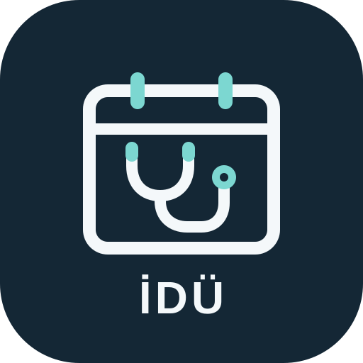
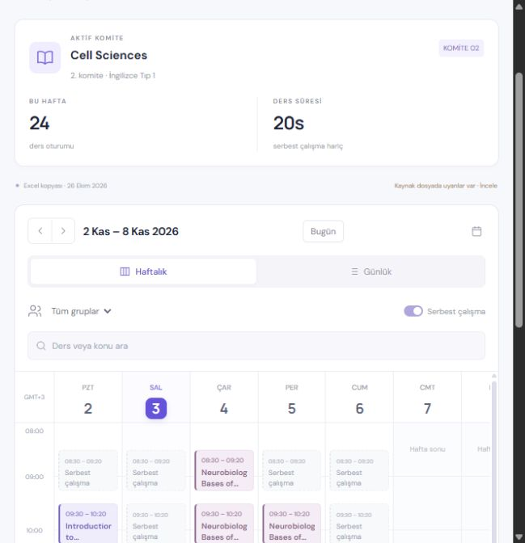
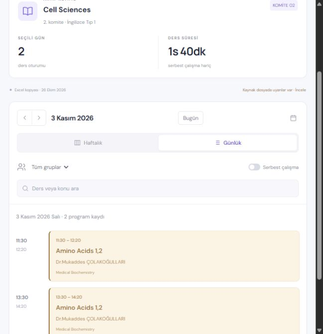
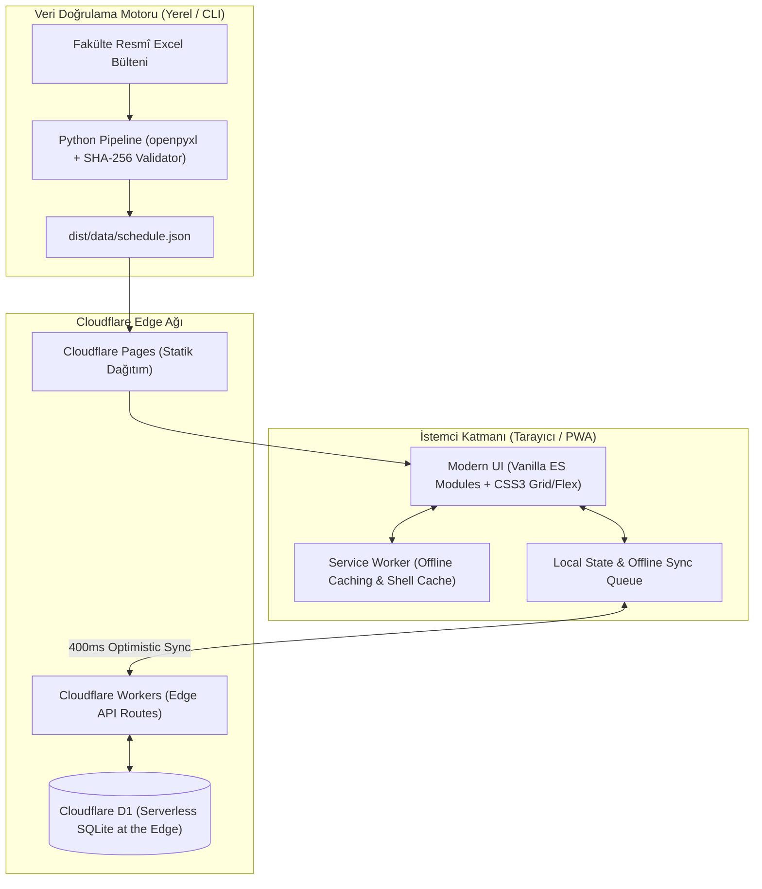

  

  # 🩺 İDÜ Campus — Tıp Akademik Ajandası

  **İzmir Demokrasi Üniversitesi Tıp Fakültesi Öğrencileri İçin Yeni Nesil, Sıfır Bağımlılıklı ve Gizlilik Odaklı PWA Ajandası**

  
  
  
  
  

   

  

    <i>"Resmî ve karmaşık Excel tablolarına bakarak ders ve amfi aramaya son! Cebinizde anlık güncellenen, kişiselleştirilebilen, çevrimdışı çalışan ve devam barajınızı kuruşu kuruşuna hesaplayan akıllı bir akademik asistan."</i>
  

   

  <a href="https://idu-campus.pages.dev/"><strong>🌐 Canlı Uygulamayı Hemen Dene »</strong></a>
    

---

## 📸 Ekran Görüntüleri

  <table border="0">
    <tr>
      <td align="center" width="65%">
        
         
        <em>Masaüstü: Yatay Zaman Akışı, Canlı Saat Çizgisi, Komite Filtreleri ve Ders Detayları</em>
      </td>
      <td align="center" width="35%">
        
         
        <em>Mobil PWA: Dokunmatik Gün Seçici, Akıllı Ders Kartları ve Hızlı Menü</em>
      </td>
    </tr>
  </table>

---

## 💡 Neden İDÜ Campus?

Tıp fakültesi eğitimi; komiteler, teorik amfi dersleri, laboratuvar/pratik oturumları, grup bölünmeleri ve sürekli revize edilen ders programlarıyla son derece dinamik bir süreçtir. 

Öğrenciler dönem boyunca şu temel sorunlarla karşılaşıyordu:
* **Statik ve Karmaşık Excel Dosyaları:** Telefonda açması zor, yüzlerce satır ve sütun arasında o anki dersi bulmak vakit alıyor.
* **Son Dakika Değişiklikleri:** Ertelenen dersler, değişen saatler veya telafi dersleri resmi Excel üzerinde takip edilemiyor.
* **Kritik Tıp Devam Barajı:** Teorik derslerde **%30**, pratik/laboratuvarda **%20** devamsızlık sınırı vardır; bu sınırı aşmak dönemi doğrudan tekrarlamak anlamına gelir.
* **Amfilerde Çekmeyen İnternet:** Fakülte binalarında ve laboratuvarlarda internet kesildiğinde programlara ulaşılamıyordu.
* **Gizlilik ve Veri Güvenliği:** Birçok öğrenci ajandası gereksiz yere telefon, e-posta ve kişisel veri talep ediyor.

**İDÜ Campus**, bu problemleri kökten çözmek için tıp öğrencileri tarafından bağımsız olarak geliştirildi.

---

## ✨ Öne Çıkan Süper Özellikler

### 1. 📅 Akıllı & Canlı Akış Takvimi (Flow Calendar)
- **Günlük ve Haftalık Mod:** Masaüstünde kesintisiz yatay zaman tüneli, mobilde pratik gün seçici ve dokunmatik kartlar.
- **Canlı Saat Çizgisi (Live Indicator):** O anki saati gösteren dinamik kırmızı çizgi; mevcut dersi ve sıradaki dersi anında vurgular.
- **Anabilim Dalına Göre Renk Kodlaması:** Tıbbi Biyoloji, Biyofizik, Tıbbi Biyokimya, Anatomi, Histoloji gibi derslerin renkleri sabit kalır; konu veya derslik değişse de gözünüz aradığını anında bulur.
- **Uygulama Grubu Filtresi:** Grup A, B, C, D veya Tüm Gruplar arasında tek tıkla geçiş. Ortak dersler asla gizlenmez.
- **Serbest Çalışma Saatleri:** İsteğe bağlı olarak boş saatleri ve serbest çalışma bloklarını açıp kapatabilme.

### 2. 📌 Kişisel Ders Taşıma & Raptiyeleme (v1.8.0+)
- **Ertelemelere ve Değişikliklere Esnek Çözüm:** Hoca veya sınıf kararıyla günü/saati değişen dersleri takvim üzerinde dilediğin güne taşı!
- **3D Raptiye & Kıvrık Kağıt Tasarımı:** Taşınan dersler orijinal yerinde üzeri çizili/ertelenmiş görünürken, taşındığı günde şık bir 3D raptiye ikonu ile öne çıkar.
- **Çakışma Kontrolü:** Taşıma sırasında başka bir dersle saat çakışması varsa sistem seni uyarır.
- **Not Ekleme:** "Mukaddes hoca ile perşembe 10.30'a ertelendi" gibi özel hatırlatma notları iliştirilebilir.

### 3. 📊 Tıp Devam Barajı & Komite Analitiği (v1.7.1+)
- **Tek Dokunuşla Yoklama:** Ders kartının üzerindeki butona basarak **✓ Var**, **✕ Yok**, **− İptal** işaretleme.
- **Günü Toplu İşaretleme:** Tüm günün derslerini tek tıkla "Var" olarak kaydedebilme.
- **Resmî Baraj Takipçisi:** Tıp Fakültesi yönetmeliğine uygun olarak:
  - **Teorik Dersler:** %30 devamsızlık barajı
  - **Pratik/Laboratuvar:** %20 devamsızlık barajı
- **Kalan Hak Simülasyonu & Risk Bildirimleri:** Hangi dersten kaç saat daha kalabileceğinizi gösteren renkli ilerleme çubukları ve kritik seviyede sarı/kırmızı alarm rozetleri.
- **Komite Geri Sayımı & Ders Ağırlıkları:** Aktif komite sınavına kaç gün kaldığı, komitedeki toplam ders saatleri ve soru dağılım ağırlıkları.
- **Muafiyet (Dikkate Alınmayan Dersler):** YÖK zorunlu ortak dersleri veya muaf olunan dersleri yoklama havuzundan hariç tutabilme.

### 4. 🔒 Sıfır Kişisel Veri & Anlık Bulut Eşitleme (Cloud Sync v1.8.3)
- **Gizlilik Manifestosu:** E-posta yok, telefon yok, TC kimlik veya öğrenci numarası yok!
- **Öğrenci Hesabı:** Sadece dilediğin `@kullanici_adi` ve sistemin sana özel ürettiği **4 haneli güvenli PIN** ile tüm cihazlarında oturum aç.
- **Tıp Temalı Avatarlar:** Stetoskop 🩺, DNA/Genetik 🧬, Mikroskop 🔬, Beyin/Nöroloji 🧠, Klinik 🏥, Yıldız ✨.
- **Canlı Senkronizasyon Durumu:**
  - `✓ Eşitlendi` (Yeşil)
  - `↻ Eşitleniyor…` (Mavi)
  - `⚠ Çevrimdışısın` (Sarı)
- **400ms Ultra Hızlı Eşitleme:** Bir dersi taşıdığınızda veya yoklama verdiğinizde 400 milisaniye içinde Cloudflare D1 bulutuna şifreli olarak yedeklenir.
- **F5 & Sekme Kapatma Koruması:** Sayfa yenilense veya tarayıcı aniden kapansa dahi yerel kuyruktaki değişiklikler asla kaybolmaz.
- **Çevrimdışı .txt Yedek Desteği:** Tek tıkla insan tarafından okunabilir `.txt` yedeği indirme ve geri yükleme.
- **Eski Sistem Köprüsü:** Önceki sürümlerde kullanılan 16 haneli anonim yedek kodlarını yeni hesaba taşıma köprüsü.

### 5. ⚡ Offline-First PWA (Progressive Web App)
- **Amfilerde Sıfır Kesinti:** Service Worker desteği sayesinde internet tamamen kesilse bile son açılan program kusursuz çalışır.
- **Sıfır Bağımlılık (Zero External Dependencies):** React, Vue veya ağır kütüphaneler yok! Saf modern JavaScript (ES Modules) ve saf CSS.
- **Ultra Hafif:** Tüm uygulamanın toplam boyutu **150 KB**'ın altındadır; saniyeden kısa sürede açılır.
- **Ana Ekrana Ekleme:** iOS Safari ve Android Chrome üzerinde gerçek bir mobil uygulama gibi tam ekran çalışır.

### 6. 🔍 Şeffaf Kaynak Takibi & Program Farkları
- **Doğrulanmış Excel Motoru:** Okulun yayınladığı resmî Excel bültenini SHA-256 hash doğrulamasından geçiren Python ayrıştırıcı.
- **Eksik/Atlanan Satır Saydamlığı:** Kaynaktaki belirsiz tarih veya saatler gizlenmez, sayaç ve kaynak penceresinde açıkça listelenir.
- **Program Değişiklikleri Paneli:** Revizyonlar arasında hangi dersin eklendiğini, değiştiğini veya kaldırıldığını gösteren otomatik fark (diff) arayüzü.

### 7. 💬 Kriptografik Takip Kodlu Anonim Geri Bildirim
- **Birlikte İyileştirelim:** Bir hata fark ettiğinde veya öneri sunmak istediğinde uygulama içinden tek tıkla mesaj gönderebilirsin.
- **Özel Takip Kodu:** Gönderim yapıldığında üretilen şifreli takip koduyla, yönetici cevabını ve inceleme sürecini (`Yeni` → `İnceleniyor` → `Düzeltildi`) anbean takip edebilirsin.

---

## 📈 Sürüm Evrimi ve Gelişim Yolculuğu

İDÜ Campus, ilk günden bugüne tıp öğrencilerinin gerçek sınıf içi deneyimleri ve geri bildirimleriyle adım adım olgunlaştı:

| Sürüm Grubu | Öne Çıkan Geliştirmeler & Dönüm Noktaları | Durum |
| :--- | :--- | :---: |
| **v1.0 - v1.3** | • İlk prototip: Resmî Excel'den günlük ve haftalık takvim üretimi • Tarih gezinmesi, A/B/C/D grup filtreleri ve serbest çalışma gösterimi • Açık/Koyu tema ve responsive mobil arayüz temelleri | Tamamlandı ✅ |
| **v1.4 - v1.5** | • Kurul Excel ayrıştırıcısı ve otomatik gün aralığı tanıma • SHA-256 kaynak takip motoru ve şeffaf satır kapsam raporu • Service Worker ile çevrimdışı önbellekleme (Offline-first) | Tamamlandı ✅ |
| **v1.6** | • **Akış (Flow) Tasarımı:** Masaüstünde yatay zaman tüneli, mobilde gün seçici • Canlı saat çizgisi, dinamik ders detay paneli • Cihazda çalışan yerel asistan (Qwen NLP & Türkçe Niyet Modeli) denemeleri | Tamamlandı ✅ |
| **v1.7** | • **Yoklama Takip Modülü:** Tek tıkla Var / Yok / İptal ve günü toplu işaretleme • Tıp Fakültesi devam barajı analitiği (%30 Teorik / %20 Pratik) • Komite sınavı geri sayımı, komite bazlı soru/ders ağırlık dağılımı • Cloudflare D1 tabanlı anonim bulut yedekleme ve .txt dışa aktarım | Tamamlandı ✅ |
| **v1.8.0** | • **Gizlilik Odaklı Öğrenci Hesapları:** E-postasız / Telefonsuz `@kullanici` ve 4 haneli PIN • Tıp temalı avatarlar ve profil yönetim merkezi • **Kişisel Ders Taşıma (Raptiye):** Çakışma kontrollü ders erteleme/yer değiştirme | Tamamlandı ✅ |
| **v1.8.1 - v1.8.3** | • **Canlı Senkronizasyon Durumları:** `✓ Eşitlendi`, `↻ Eşitleniyor…`, `⚠ Çevrimdışısın` • 400ms ultra hızlı bulut aktarımı ve sayfa yenileme (F5) / sekme kapatma koruması • Çoklu cihazlar arasında taşınan derslerin ve yoklamanın anlık senkronizasyonu | **Aktif Yayında** 🚀 |

Detaylı sürüm geçmişi için [CHANGELOG.md](CHANGELOG.md) belgesini inceleyebilirsiniz.

---

## 🏗️ Teknoloji Mimarisi

İDÜ Campus, gereksiz karmaşıklıktan uzak, modern web standartlarının gücünü sonuna kadar kullanan bir mimariyle inşa edilmiştir:

- **Frontend:** Saf ES6+ Modülleri, CSS Custom Properties, modern CSS Grid/Flexbox, Native HTML Dialog elemanları. (Hiçbir npm paketi ya da bundle build adımı gerektirmez!)
- **PWA & Cache:** Network-first veri stratejisi, cache-first statik kabuk stratejisi.
- **Edge Backend:** Cloudflare Pages Functions, Worker API'leri.
- **Veritabanı:** Cloudflare D1 (Dünyanın dört bir yanındaki edge noktalarında düşük gecikmeli serverless SQLite).
- **Veri Boru Hattı:** Python 3, `openpyxl`, regex normalizasyonu ve SHA-256 bütünlük kontrolü.

Daha fazla teknik detay için [docs/ARCHITECTURE.md](docs/ARCHITECTURE.md) dosyasına göz atın.

---

## 📱 Telefonun Ana Ekranına Nasıl Eklenir? (PWA Kurulumu)

Uygulamayı bir kez açtıktan sonra internetsiz ortamlarda da doğrudan kullanabilmek için ana ekranınıza ekleyebilirsiniz:

### 🍏 iOS (iPhone & iPad - Safari)
1. Safari tarayıcısında **[idu-campus.pages.dev](https://idu-campus.pages.dev/)** adresini açın.
2. Alttaki **Paylaş** simgesine (kare içinden yukarı ok) dokunun.
3. Listeyi aşağı kaydırıp **"Ana Ekrana Ekle"** seçeneğini seçin.
4. Sağ üstteki **"Ekle"** butonuna basın. Artık ana ekranınızdaki İDÜ stetoskop simgesiyle tek dokunuşla açabilirsiniz.

### 🤖 Android (Google Chrome)
1. Chrome tarayıcısında **[idu-campus.pages.dev](https://idu-campus.pages.dev/)** adresini açın.
2. Sağ üstteki **üç nokta (⋮)** simgesine dokunun.
3. **"Uygulamayı Yükle"** veya **"Ana Ekrana Ekle"** seçeneğine basın.
4. Onaylayın. Uygulama bağımsız bir pencerede, adres çubuğu olmadan tam ekran çalışacaktır.

---

## 🛡️ Gizlilik ve Etik İlkeler

* **Sıfır Kişisel Veri Toplama:** Kullanıcılardan ad-soyad zorunluluğu, e-posta, cep telefonu numarası, öğrenci numarası veya şifre istenmez.
* **İzleme ve Çerez Yok:** Üçüncü taraf analitik araçları (Google Analytics, Facebook Pixel vb.) veya reklam takipçileri bulunmaz.
* **Şeffaf Veri Depolama:** Yoklama ve ders taşıma verileri yalnızca kullanıcının belirlediği kullanıcı adı ve sistemin ürettiği PIN karmasıyla (salted hash) eşleştirilerek D1 üzerinde saklanır.
* **Resmî Bilgi Güvencesi:** İDÜ Campus bağımsız bir öğrenci girişimidir. Sitedeki her sayfada öğrencilere ders, sınav ve yönetmelik bilgilerini üniversitenin resmî kaynaklarından doğrulama uyarısı sunulur.

Ayrıntılı ilkeler için [docs/PRIVACY.md](docs/PRIVACY.md) belgesini inceleyin.

---

## 🗺️ Gelecek Yol Haritası (Roadmap)

- [x] **Faz 1:** Temel Takvim, Günlük/Haftalık Görünüm, A/B/C/D Filtreleri
- [x] **Faz 2:** PWA Desteği, Çevrimdışı Çalışma, Kaynak Doğrulama Motoru
- [x] **Faz 3:** Yoklama Takibi, Tıp Devam Barajı (%30/%20), Komite Analitiği
- [x] **Faz 4:** Sıfır Kişisel Verili Öğrenci Hesapları, 400ms Cloudflare D1 Eşitleme, Kişisel Ders Taşıma (Raptiye)
- [ ] **Faz 5 (Sıradaki):** Resmî Fakülte Duyuruları Takip Akışı ve Anlık Hatırlatmalar
- [ ] **Faz 6:** Apple / Google Takvim İçin Otomatik `.ics` Dışa Aktarımı ve Takvim Abonelik URL'i
- [ ] **Faz 7:** Diğer Sınıflar (Dönem 2, 3 vb.) İçin Çoklu Dönem Desteği

Detaylı planlama için [ROADMAP.md](ROADMAP.md) dosyasına göz atabilirsiniz.

---

## ⚖️ Telif Hakları ve Hukuki Sorumluluk Reddi (Disclaimer)

* **Mülkiyet:** İDÜ Campus'un tüm hakları saklıdır (All Rights Reserved). Uygulamanın kaynak kodları, görsel tasarımları ve veri modelleri izinsiz kopyalanamaz, çoğaltılamaz ve dağıtılamaz.
* **Bağımsız Girişim:** İDÜ Campus bağımsız bir öğrenci girişimidir; İzmir Demokrasi Üniversitesi'nin resmî idari sistemi değildir.
* **Sorumluluk Reddi:** Yazılım "olduğu gibi" (AS IS) sağlanmaktadır. Uygulamadaki ders saatleri, sınavlar veya devamsızlık hesaplamalarındaki olası gecikme, hata ya da uyuşmazlıklardan; kaçırılan ders ve sınavlardan ya da devamsızlık aşımından dolayı geliştiriciler hiçbir şekilde hukuki veya maddi olarak sorumlu tutulamaz. Nihai doğrulama yükümlülüğü her zaman öğrenciye aittir.

---

## 🤝 Geri Bildirim ve İletişim

İDÜ Campus topluluk odaklı bir vizyonla yürütülmektedir:
- Bir program hatası veya teknik problem mi fark ettiniz? Canlı sitedeki **"Geri Bildirim"** bölümünden anonim olarak iletebilirsiniz.
- Öneri ve destek süreçleri hakkında detaylar için [CONTRIBUTING.md](CONTRIBUTING.md) ve [docs/PRIVACY.md](docs/PRIVACY.md) belgelerini inceleyebilirsiniz.

---

  İzmir Demokrasi Üniversitesi Tıp Fakültesi Öğrencileri Tarafından Sevgi ve Özenle Geliştirildi. ❤️
   
  Tüm Hakları Saklıdır © 2026 IDU Campus Contributors.

