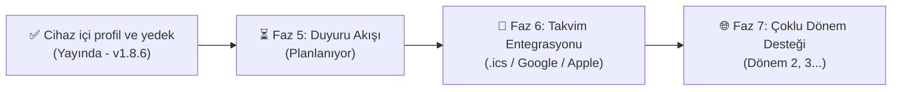

# 🗺️ İDÜ Campus — Geliştirme Yol Haritası (Roadmap)

Bu belge, İDÜ Campus projesinin geçmişten bugüne katettiği mesafeyi, şu an bulunduğu aşamayı ve geleceğe yönelik geliştirme hedeflerini açık bir şekilde ortaya koymaktadır.

---

## 📌 Mevcut Durum Özeti (Kasım 2026 İtibarıyla)

* **Aktif Canlı Sürüm:** `v1.8.6`
* **Canlı Dağıtım Adresi:** [idu-campus.pages.dev](https://idu-campus.pages.dev/)
* **Platform:** Web / PWA (iOS & Android Ana Ekran Desteği)
* **Kapsam:** İzmir Demokrasi Üniversitesi Tıp Fakültesi (İngilizce Tıp 1. Sınıf)
* **Temel Başarılar:** 
  - İsteğe bağlı profil ve yoklama tarayıcıda saklanır. TXT yedeği yüklemeden önce değişiklikler gösterilir.
  - Komite ve yıl sonu devamsızlık tahminleri ayrı gösterilir.
  - Ders taşıma / raptiyeleme özelliğiyle hoca ertelemelerine tam uyum sağlandı.
  - Kaydedilmiş ders programı çevrimdışı açılabilir. Uygulama otomatik güncellenir ve elle güncelleme kontrolü sunar.
  - Takvimde son kaynak kontrolü ve Yemekhane sayfasında günün menüsü görünür.

---

## 🏁 Tamamlanan Fazlar

### ✅ Faz 1: Temel Takvim ve Görüntüleme (v1.0 - v1.3)
- [x] Resmî Excel dosyasından otomatik JSON veri modeli üretimi.
- [x] Günlük ve haftalık ders programı görünümü.
- [x] Anabilim dalı bazlı renk kodlaması (Tıbbi Biyoloji, Biyofizik, Biyokimya, Anatomi vb.).
- [x] Uygulama grubu seçimi (Grup A, B, C, D) ve serbest çalışma filtreleri.
- [x] Masaüstü ve mobil uyumlu responsive arayüz.
- [x] Koyu ve Açık tema tercihlerinin yerel depolamada saklanması.

### ✅ Faz 2: Çevrimdışı Çalışma ve Şeffaf Veri Doğrulama (v1.4 - v1.5)
- [x] Service Worker ile çevrimdışı PWA desteği (Network-first veri, Cache-first arayüz kabuğu).
- [x] Python ile SHA-256 hash tabanlı Excel kaynak takip motoru.
- [x] Kaynaktaki eksik veya format dışı saat satırlarını saydam gösteren Kaynak Raporu.
- [x] Revizyonlar arasındaki eklenen/kaldırılan dersleri listeleyen Program Farkları (Diff) paneli.
- [x] iOS Safari ve Android Chrome için ana ekrana ekleme rehberi.

### ✅ Faz 3: Yoklama Takibi & Tıp Devamsızlık Barajı (v1.7.0 - v1.7.1)
- [x] Tek dokunuşla Var (✓), Yok (✕), İptal (−) işaretleme.
- [x] Günü toplu "Var" olarak işaretleme kısayolu.
- [x] Tıp Fakültesi devam kuralları: Teorik dersler için %30, Pratik dersler için %20 devamsızlık barajı hesaplama.
- [x] Kalan devamsızlık hakkı ilerleme çubukları ve kritik seviye uyarı bildirimleri.
- [x] Komite bazlı bölümleme ve komite sınavı geri sayım sayacı.
- [x] Komitedeki derslerin soru ağırlık dağılım analitiği.
- [x] Muafiyet (dikkate alınmayan) ders seçimi.

### ✅ Faz 4: Ders Taşıma ve Eski Hesap Sistemi (v1.8.0 - v1.8.3)

Hesap, PIN ve bulut eşitleme v1.8.5 ile kapatıldı. Kişisel ders taşıma cihazda çalışmaya devam ediyor.

- [x] **Önceki hesap sistemi:** E-posta veya telefon gerekmeden dilediğin `@kullanici` adı ve 4 haneli PIN ile oturum açma.
- [x] Tıp temalı profil avatarları (Stetoskop, Genetik, Mikroskop, Nöroloji, Klinik vb.).
- [x] **Kişisel Ders Taşıma (Raptiye):** Ertelenen veya saati değişen dersleri takvimde başka güne/saate taşıma ve özel not iliştirme.
- [x] 3D raptiye ve kıvrık kağıt görsel tasarımı; ders saati çakışma uyarıları.
- [x] **400ms Ultra Hızlı Senkronizasyon:** Değişikliklerin Cloudflare D1 veritabanına anında yedeklenmesi.
- [x] **Canlı Senkronizasyon Durum Rozetleri:** `✓ Eşitlendi`, `↻ Eşitleniyor…`, `⚠ Çevrimdışısın`.
- [x] F5 / Sayfa yenileme ve sekme kapatma anında veri kaybını önleyen çevrimdışı kuyruk koruması.
- [x] Eski 16 haneli anonim yedek kodlarını yeni hesaba taşıma geçiş köprüsü.

---

## 🚀 Gelecek Hedefleri ve Yol Haritası

### ⏳ Faz 5: Resmî Fakülte Duyuruları ve Sınıf Akışı (Geliştirme Aşamasında)
- [ ] Fakülte web sitesindeki resmî duyuruları otomatik tarayan ve sınıfı ilgilendiren duyuruları filtreleyen bot.
- [ ] Uygulama içinde duyuru akışı sekmesi: Tarihi, resmî kaynak bağlantısı ve özetiyle bildirim paneli.
- [ ] Kullanıcı tercihlerine göre yeni duyuru geldiğinde arayüzde tek seferlik okunmamış bildirim rozeti.

### 🔮 Faz 6: Takvim Dışa Aktarımı & Abonelik (.ics)
- [ ] Kişiselleştirilmiş ders programını (taşınan dersler dahil) Apple Takvim, Google Takvim veya Outlook'a aktarmak için tek tıkla `.ics` dosyası indirme.
- [ ] Canlı takvim abonelik bağlantısı (webcal://) üreterek telefonun yerel takvim uygulamasıyla sürekli senkron kalma.

### 🌐 Faz 7: Modülerleşme & Çoklu Dönem Desteği
- [ ] Mimariyi İngilizce Tıp 1. Sınıf'tan diğer dönemlere (Dönem 2, Dönem 3 vb.) ve Türkçe Tıp programına genişletebilecek modüler JSON/Excel konfigürasyon yapısı.
- [ ] Dönemler arası tek dokunuşla geçiş sağlayabilecek üst sınıf seçici paneli.

### 🤖 Faz 8: Akıllı Asistan Deneyimi (Ar-Ge)
- [ ] Tarayıcı üzerinde çalışan yerel, gizlilik dostu NLP modeliyle:
  - "Yarın ilk dersim kaçta?"
  - "Biyofizikten kaç devamsızlık hakkım kaldı?"
  - "Komite sınavına kaç gün var?"
  gibi soruları internet harcamadan saniyesinde yanıtlayan sohbet arayüzünün kararlı sürüme taşınması.

---

## 💬 Fikirler ve Öneriler

Bu yol haritası statik değildir; sınıftaki ve fakültedeki öğrencilerin taleplerine göre şekillenir. Yeni bir özellik önermek için canlı sitedeki **Geri bildirim** bölümünde gösterilen e-posta adresine yazabilirsin.
