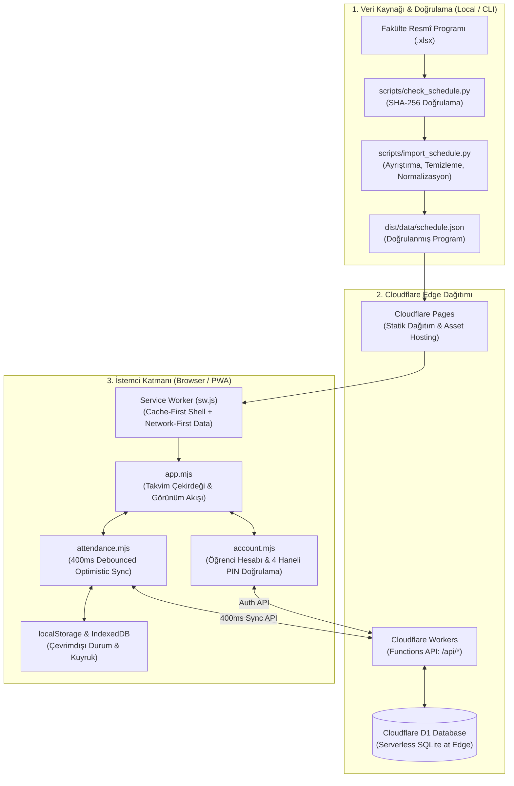
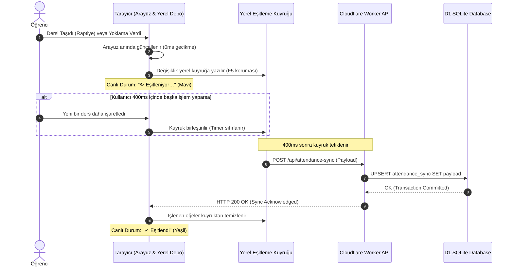
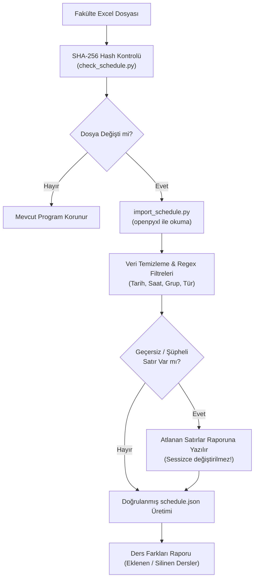

# 🏗️ Sistem Mimarisi ve Teknik Dokümantasyon

İDÜ Campus; sıfır bağımlılık ilkesi (zero-dependency), en uç noktalarda hesaplama (edge computing), çevrimdışı öncelikli mimari (offline-first) ve katı veri minimizasyonu prensiplerine göre tasarlanmıştır.

Bu belgede projenin teknik katmanları, veri boru hattı, veritabanı şeması ve senkronizasyon algoritmaları açıklanmaktadır.

---

## 1. Mimari Genel Bakış



---

## 2. İstemci Mimarisi (Frontend)

### Sıfır Dış Bağımlılık (Zero-Dependency Vanilla JS)
- Modern web platformunun yerel yetenekleri (ES2022+ Modülleri, CSS Custom Properties, Native `<dialog>` elemanları) kullanılmıştır.
- **Npm paketi, Webpack/Vite derleme adımı veya büyük kütüphaneler (React/Vue/Angular) yoktur.**
- Sayfa ilk açılışta herhangi bir derleme ve çözümleme yükü olmadan doğrudan tarayıcı tarafından yorumlanır.
- Toplam statik kabuk boyutu **< 150 KB**'tır.

### Servis Çalışanı ve Çevrimdışı Stratejisi (Service Worker)
- **Kabuk Varlıkları (Shell Cache):** HTML, CSS, SVG logoları ve ES modülleri sürüm bazlı önbelleğe alınır (`VERSION` değiştiğinde otomatik temizlenir).
- **Program Verisi (Data Cache - Network-First):** `dist/data/schedule.json` dosyası önce ağdan çekilmeye çalışılır; ağ erişimi yoksa anında yerel kopyadan sunulur.
- **Form ve Taslak Koruması:** Kullanıcının açık bir geri bildirim taslağı veya düzenleme ekranı varsa, arka planda gelen yeni sürümün sayfayı aniden yenilemesi engellenir.

---

## 3. Bulut ve Arka Yüz Mimarisi (Edge & D1)

Arka yüz, Cloudflare Pages Functions üzerinde çalışan hafif, sunucusuz (serverless) fonksiyonlardan oluşur.

### Temel API Uç Noktaları

| Uç Nokta | Metot | Görev |
| :--- | :---: | :--- |
| `/api/account` | `POST` | Öğrenci hesabı oluşturma, PIN doğrulama, token üretimi ve profil güncelleme |
| `/api/attendance-sync` | `GET / POST` | Yoklama durumları, taşınan dersler ve özel notların anlık çift yönlü senkronizasyonu |
| `/api/feedback` | `POST` | Anonim hata/öneri bildirimi alma ve benzersiz bilet/takip kodu üretme |
| `/api/track` | `GET` | Özel takip kodu ile geri bildirim durumunu ve yönetici yanıtını sorgulama |
| `/api/program-extra` | `GET` | İptal edilen veya sonradan eklenen ders duyurularını listeleme |

### Cloudflare D1 Veritabanı Modeli (SQLite at the Edge)

Veritabanı; coğrafi olarak kullanıcıya en yakın Cloudflare edge noktalarında çalışan sunucusuz SQLite altyapısıdır (Cloudflare D1).

```sql
-- Öğrenci Hesapları Tablosu (Sıfır Kişisel Veri Modeli)
CREATE TABLE IF NOT EXISTS student_accounts (
  id TEXT PRIMARY KEY,
  username TEXT UNIQUE NOT NULL,      -- @kullanici_adi
  display_name TEXT NOT NULL,         -- Görünen İsim (Serbest metin)
  pin_hash TEXT NOT NULL,             -- SHA-256(PIN + Salt)
  pin_salt TEXT NOT NULL,             -- Kullanıcıya özel kriptografik tuz
  avatar_id TEXT DEFAULT 'initial',   -- Profil simgesi seçimi
  failed_attempts INTEGER DEFAULT 0,  -- Brute-force koruması
  locked_until INTEGER DEFAULT 0,     -- Geçici hesap kilitleme damgası
  created_at INTEGER NOT NULL,
  updated_at INTEGER NOT NULL
);

-- Bulut Eşitleme Tablosu (Yoklama & Taşınan Dersler)
CREATE TABLE IF NOT EXISTS attendance_sync (
  account_id TEXT PRIMARY KEY,
  sync_payload TEXT NOT NULL,         -- JSON: { attendance: {...}, movedLessons: {...} }
  version INTEGER DEFAULT 1,
  updated_at INTEGER NOT NULL,
  FOREIGN KEY (account_id) REFERENCES student_accounts(id) ON DELETE CASCADE
);

-- Anonim Geri Bildirim Tablosu
CREATE TABLE IF NOT EXISTS feedback_tickets (
  ticket_id TEXT PRIMARY KEY,         -- Kriptografik Takip Kodu
  category TEXT NOT NULL,             -- schedule | bug | suggestion
  message TEXT NOT NULL,
  status TEXT DEFAULT 'new',          -- new | investigating | resolved | closed
  admin_reply TEXT,
  created_at INTEGER NOT NULL,
  updated_at INTEGER NOT NULL
);
```

---

## 4. Senkronizasyon ve Veri Bütünlüğü Algoritması

İDÜ Campus, anlık kullanıcı hareketlerini kesintiye uğratmadan yüksek hızda kaydetmek için **İyimser Kullanıcı Arayüzü (Optimistic UI) + 400ms Debounced Sync** modelini kullanır:



### Sayfa Yenileme (F5) ve Sekme Kapatma Koruması
Kullanıcı bir dersi taşıdıktan 50 milisaniye sonra sayfayı kapatsa veya F5'e bassa bile:
1. Değişiklik önce senkron olarak `localStorage` üzerindeki eşitleme kuyruğuna yazılır.
2. Sayfa yeniden açıldığında çekirdek başlatıcı bu kuyruğu okur ve bekleyen değişiklikleri otomatik olarak buluta iletir.
3. Böylece hiçbir veri kaybı yaşanmaz.

---

## 5. Veri Doğrulama ve Excel Ayrıştırma Hattı (Data Pipeline)

Fakültenin yayımladığı ders programları doğrudan sisteme verilmez; çok aşamalı Python doğrulama motorundan geçer:



### Şeffaf Hata Politikası
Okulun kaynak tablosundaki akademik yıl dışı tarihler, mantıksız saatler veya eksik yazımlar **asla yapay zeka veya tahminle sessizce düzeltilmez**. Ayrıştırıcı bu satırları dışarıda bırakır ve arayüzdeki **"Program Kaynağı ve Satır Raporu"** penceresinde öğrencinin bilgisine sunar.
