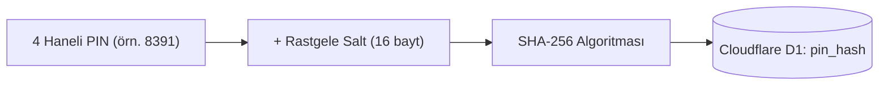

# 🔒 Gizlilik Manifestosu ve Veri Güvenliği Politikası

İDÜ Campus, "Gizlilik varsayılan olmalıdır, bir lüks değil" ilkesiyle inşa edilmiştir. Bir üniversite öğrencisi ajandasının öğrencileri gözetlemesine, gereksiz kişisel verilerini toplamasına veya e-posta/telefon listeleri oluşturmasına kesinlikle inanmıyoruz.

Bu belgede, İDÜ Campus'un sıfır kişisel veri mimarisi ve teknik güvenlik önlemleri açıklanmaktadır.

---

## 🛡️ Temel İlkelerimiz

### 1. Sıfır Kişisel Veri (Zero Personal Data)
İDÜ Campus'te hesap açarken:
- ❌ **E-posta adresi istenmez.**
- ❌ **Telefon numarası istenmez.**
- ❌ **T.C. Kimlik Numarası istenmez.**
- ❌ **Öğrenci numarası istenmez.**
- ❌ **Gerçek ad-soyad zorunluluğu yoktur.** (Görünen ad alanına istediğiniz takma adı yazabilirsiniz.)

Tek gereken: Belirleyeceğiniz bir kullanıcı adı (`@kullanici_adi`) ve sistemin sizin için kriptografik olarak ürettiği **4 haneli güvenli PIN**.

---

## 🔑 4 Haneli PIN ve Güvenlik Mimarisi

Kullanıcılarımızın karmaşık şifreler hatırlamak zorunda kalmadan mobil ortamda hızlıca oturum açabilmesi, aynı zamanda güvenliğin korunması için şu önlemler alınmıştır:

### Kriptografik Özetleme (Salted Hashing)
PIN kodları veritabanında asla açık metin (plain-text) olarak saklanmaz. Her kullanıcı kaydolduğunda:
1. `crypto.getRandomValues()` ile 16 baytlık kriptografik rastgele bir tuz (`salt`) üretilir.
2. PIN ve tuz birleştirilerek SHA-256 algoritmasından geçirilir (`SHA-256(PIN + Salt)`).
3. Veritabanına yalnızca bu özet (hash) değeri kaydedilir.

### Kaba Kuvvet (Brute-Force) Koruması
4 haneli şifrelerin olası tahmin saldırılarına karşı korunması amacıyla sunucu tarafında katı kısıtlamalar uygulanır:
- Arka arkaya 5 hatalı deneme yapıldığında hesap geçici olarak kilitlenir.
- Hatalı denemeler arttıkça bekleme süresi katlanarak artar.
- Aynı IP adresinden gelen toplu denemeler Cloudflare katmanında sınırlandırılır.

### Tek Tıkla Şifre Yenileme ve Oturum Sonlandırma
Öğrenci profil panelinden "Yeni Şifre Üret" butonuna bastığı anda sistem yeni bir 4 haneli PIN üretir ve eski oturum token'ları geçersiz kılınır. Bu sayede başka bir cihazda unutulan oturum anında kapatılmış olur.

---

## 🎟️ Anonim Geri Bildirim ve Bilet (Receipt) Sistemi

Uygulama üzerinden bir ders programı hatası bildirdiğinizde veya öneri sunduğunuzda:
- Mesajınız anonim olarak kaydedilir.
- E-posta veya telefonunuzu yazmak **tamamen isteğe bağlıdır**.
- Sistem size anında rastgele üretilen bir **Özel Takip Kodu** verir.
- Bu kodu dilediğiniz zaman **"Bildirim Takibi"** ekranına yapıştırarak yöneticinin mesajınıza verdiği yanıtı ve konunun çözülüp çözülmediğini görebilirsiniz.
- Takip kodu olmadan hiç kimse (hatta diğer öğrenciler bile) bildirimin içeriğini veya kimin yazdığını göremez.

---

## 🚫 Takipçi ve Analitik Yok

* **Google Analytics, Meta Pixel, Hotjar vb. ticari izleyiciler bulunmaz.**
* Ziyaret ve platform istatistikleri yalnızca genel aggregate (toplu) sayı olarak (örn. "bugün 42 oturum açıldı") ölçülür; IP adresleri veya kullanıcı kimlikleri ile eşleştirilmez.
* Tarayıcı parmak izi (browser fingerprinting) yöntemleri kullanılmaz.

---

## 💾 Yerel ve Çevrimdışı Depolama

* Ders programı, yoklama kayıtları ve tercihleriniz öncelikli olarak cihazınızın yerel depolama alanında (`localStorage` ve Service Worker Cache) tutulur.
* Dilediğiniz an profil panelinden **"Yedek İndir (.txt)"** butonuna basarak tüm verilerinizi açık ve okunabilir bir metin dosyası olarak cihazınıza indirebilirsiniz.
* **"Hesabı Sil"** seçeneği kullanıldığında hem cihazınızdaki hem de bulut veritabanındaki tüm verileriniz anında ve geri döndürülemez biçimde silinir.

---

  <i>Verileriniz size aittir; öyle kalmaya devam edecektir. 🩺</i>

